# Projeto RH — versão atualizada após a entrega

Esta pasta é uma revisão independente da versão originalmente entregue. Foram acrescentados **uma árvore de decisão e um Random Forest** à comparação com a regressão logística e o baseline. Os notebooks 01 e 02 mantêm a análise original; o notebook 03 teve corrigida a guarda de gráficos para poder ser executado novamente; os notebooks 04, 05 e 06 foram atualizados e executados de novo.

## O que foi realmente testado

- Baseline: `DummyClassifier(strategy='most_frequent')`, que prevê sempre a classe maioritária.
- Regressão logística: modelo da primeira versão.
- Árvore de decisão: `max_depth=5`, `min_samples_leaf=50`, `class_weight='balanced'`, `random_state=42`.
- Random Forest: `n_estimators=100`, `max_depth=8`, `min_samples_leaf=20`, `class_weight='balanced_subsample'`, `random_state=42`.

Não treinámos KNN nesta versão. Não fizemos pesquisa em grelha ou pesquisa aleatória de hiperparâmetros. A preparação aprendida fica dentro do `Pipeline` em cada fold. A escolha do modelo usa o **F1 da classe Sim em cinco folds estratificados do treino**. O limiar de decisão continua em 0,50.

| Candidato | F1 médio nos 5 folds do treino |
|---|---:|
| Baseline | 0,000 |
| Regressão logística | 0,466 |
| Árvore de decisão | 0,611 |
| Random Forest | 0,618 |

O Random Forest foi escolhido por esse critério. No teste desta revisão obteve F1 **0,605**, recall **0,746**, ROC-AUC **0,785** e Average Precision **0,512**. Cumpriu as três metas numéricas definidas no notebook 01 e superou o baseline em F1 e AP. O baseline teve F1 0,000 e AP 0,249.

## Como percorrer o projeto

Abrir os notebooks pela ordem `01` a `06`. O notebook 03 prepara os dados; o 04 treina e guarda o modelo escolhido; o 05 calcula métricas e interpreta as variáveis; o 06 demonstra previsões com o pipeline guardado. O ficheiro `preparacao_rh.py` deve permanecer na mesma pasta dos notebooks. Os dados de entrada estão em `Data/input`; os resultados atuais em `Data/output` e o pipeline em `Data/models`.

Os notebooks 03 a 06 foram executados sequencialmente nesta versão, sem células com erro. Ambiente usado na validação: Python 3.14.7, pandas 3.0.5 e scikit-learn 1.9.1. O trabalho é um protótipo pedagógico, não uma ferramenta aprovada para decisões reais de recursos humanos.

## Apresentação

Alguns diapositivos que resumem as principais etapas e resultados do projeto:

<table>
<tr><td align="center"> 01 · Capa do projeto</td><td align="center"><a href="Documentacao/Apresentacao_Projeto_4.1_slides/slide-02.png">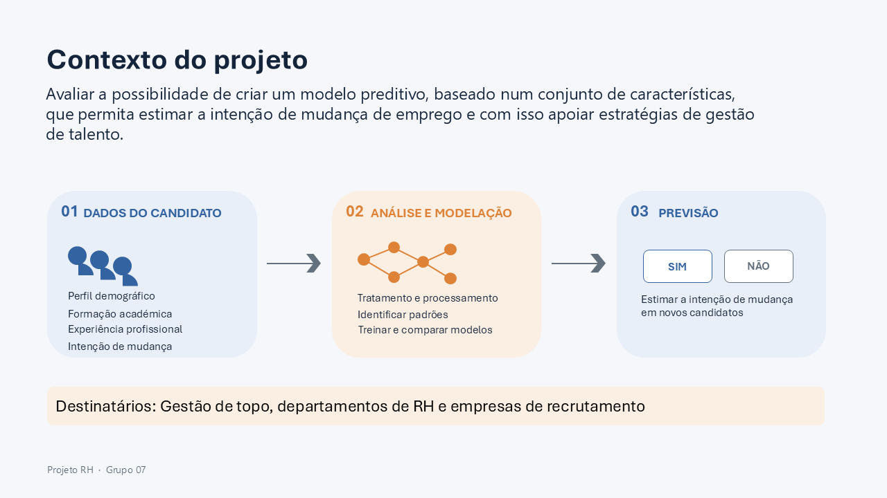</a> 02 · Contexto e objetivo</td></tr>
<tr><td align="center"><a href="Documentacao/Apresentacao_Projeto_4.1_slides/slide-04.png">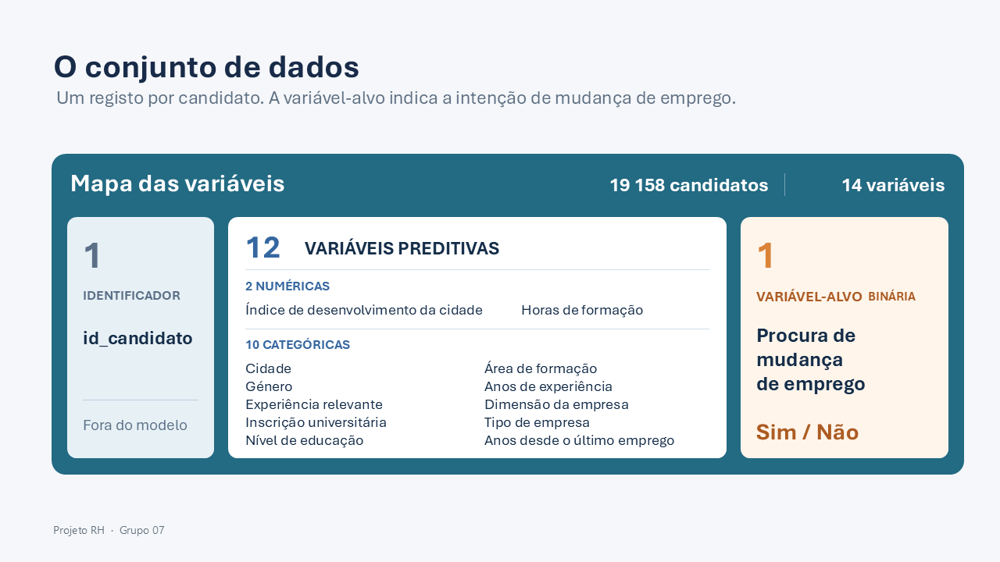</a> 04 · Conjunto de dados</td><td align="center"><a href="Documentacao/Apresentacao_Projeto_4.1_slides/slide-05.png">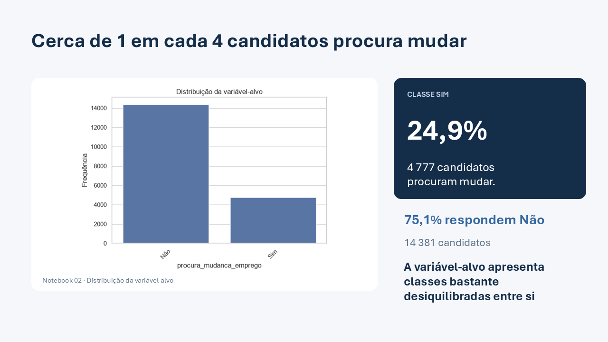</a> 05 · Distribuição da variável-alvo</td></tr>
<tr><td align="center"><a href="Documentacao/Apresentacao_Projeto_4.1_slides/slide-06.png">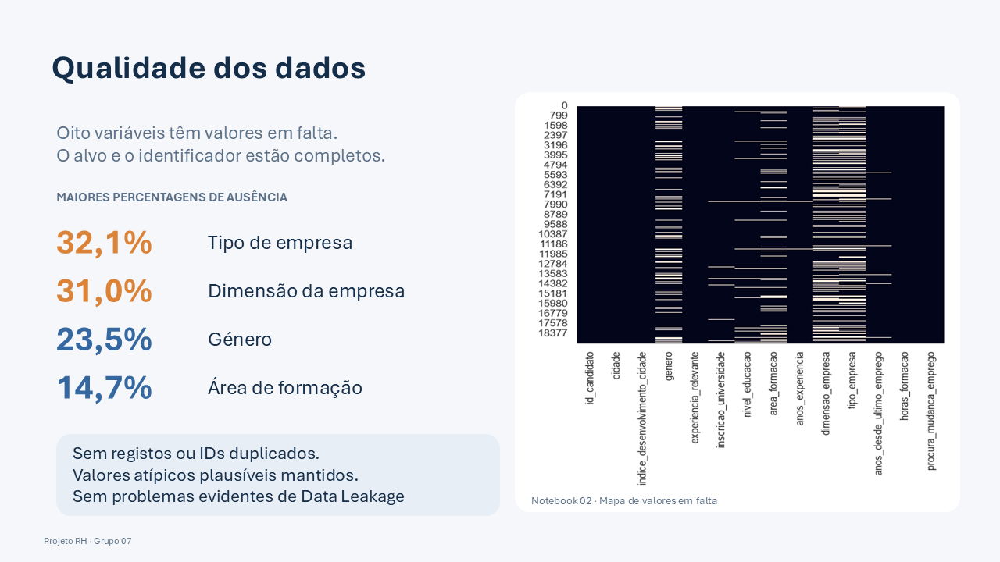</a> 06 · Qualidade dos dados</td><td align="center"><a href="Documentacao/Apresentacao_Projeto_4.1_slides/slide-11.png">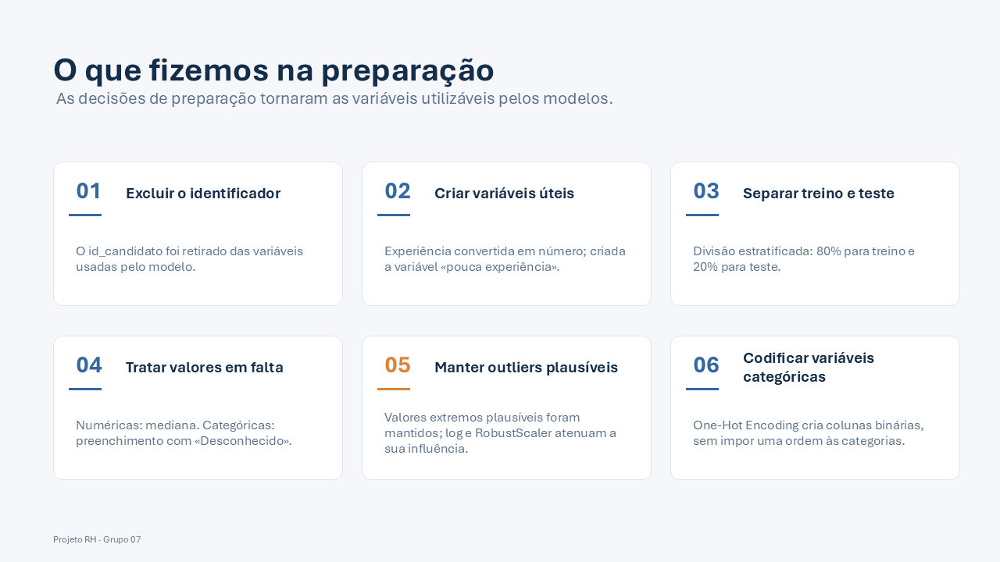</a> 11 · Preparação dos dados</td></tr>
<tr><td align="center"><a href="Documentacao/Apresentacao_Projeto_4.1_slides/slide-14.png">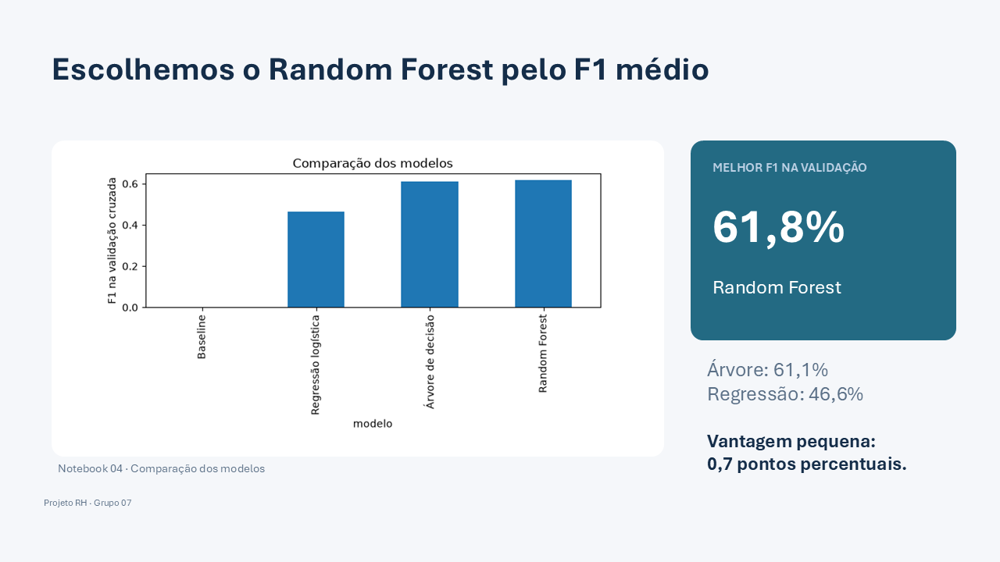</a> 14 · Escolha do modelo</td><td align="center"><a href="Documentacao/Apresentacao_Projeto_4.1_slides/slide-15.png">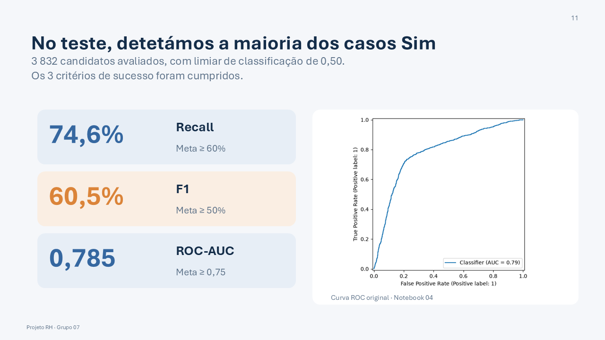</a> 15 · Desempenho no teste</td></tr>
<tr><td align="center"><a href="Documentacao/Apresentacao_Projeto_4.1_slides/slide-17.png">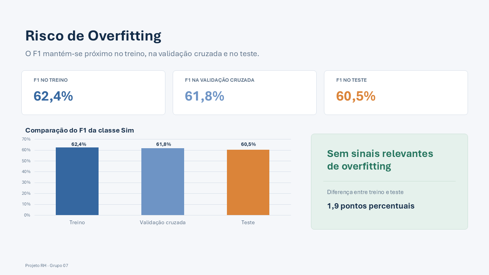</a> 17 · Avaliação do overfitting</td><td align="center"><a href="Documentacao/Apresentacao_Projeto_4.1_slides/slide-18.png">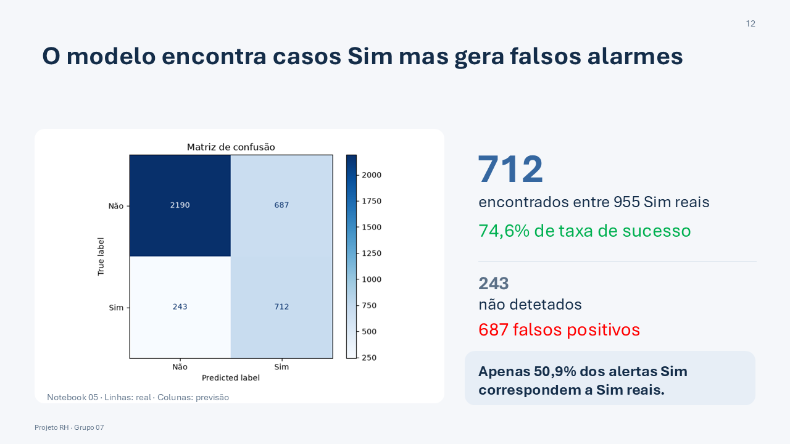</a> 18 · Matriz de confusão</td></tr>
<tr><td align="center"><a href="Documentacao/Apresentacao_Projeto_4.1_slides/slide-20.png">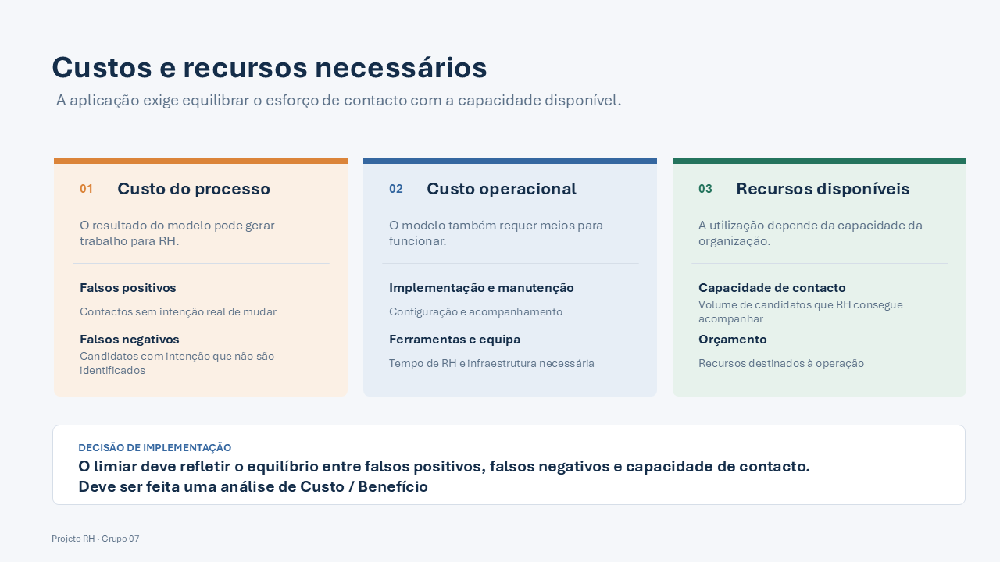</a> 20 · Custos e recursos</td><td align="center"><a href="Documentacao/Apresentacao_Projeto_4.1_slides/slide-22.png">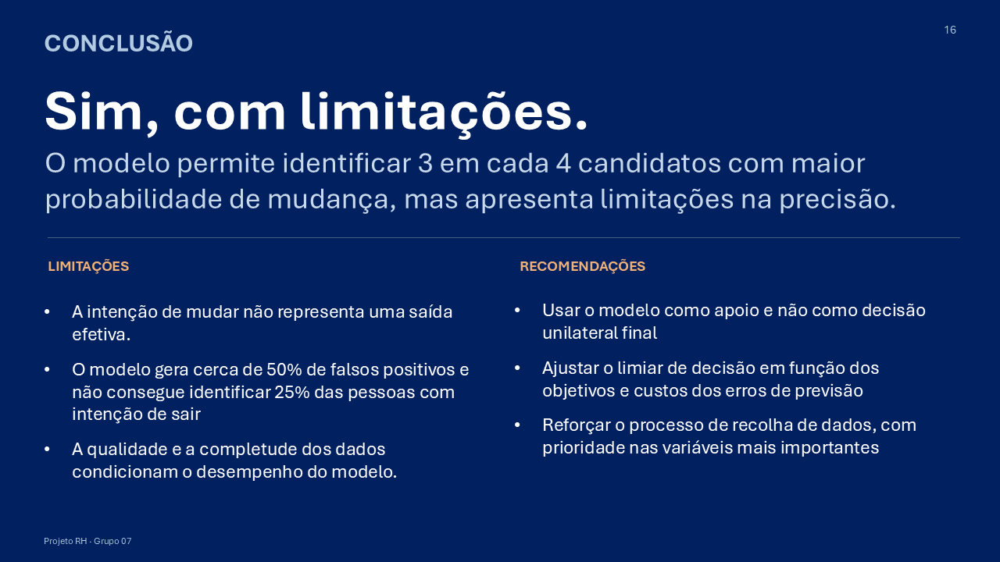</a> 22 · Conclusões</td></tr>
</table>

[Descarregar o PowerPoint completo](Documentacao/Apresentacao_Projeto_4.1.pptx)
