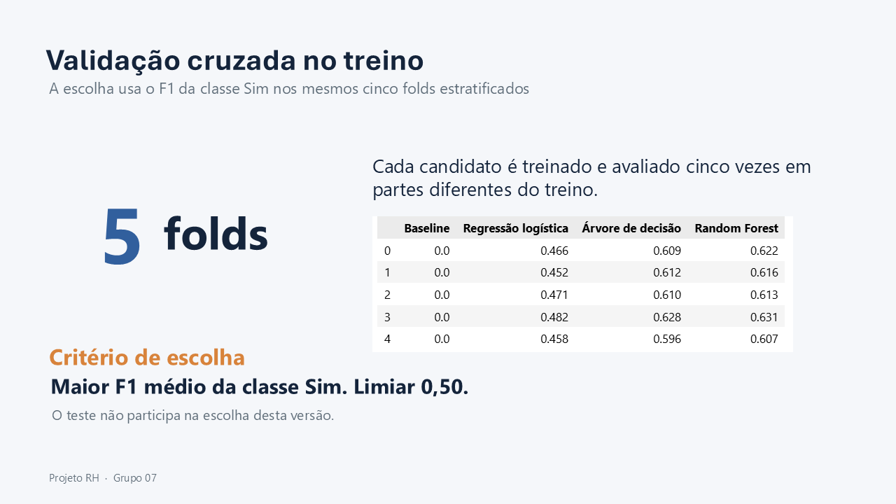

# Previsão da intenção de mudança de emprego

## 🇵🇹 Português

### Objetivo

Este projeto analisa se é possível prever a intenção de um candidato mudar de emprego a partir das suas características conhecidas. O objetivo é explorar como essa previsão pode apoiar a análise do departamento de Recursos Humanos.

### Dados

O conjunto contém **19 158 candidatos** e **14 variáveis**: um identificador, 12 variáveis preditivas e a variável-alvo binária `procura_mudanca_emprego` (Sim/Não). Cerca de **24,9%** dos registos pertencem à classe Sim.

### Preparação e modelação

A preparação remove o identificador da modelação, trata valores em falta, transforma variáveis categóricas com One-Hot Encoding e prepara as variáveis numéricas. A divisão entre treino e teste é estratificada (80/20).

Foram comparados um baseline, Regressão Logística, Árvore de Decisão e Random Forest. A escolha foi feita pelo F1 médio da classe Sim em cinco folds estratificados do conjunto de treino.

| Modelo | F1 médio na validação cruzada |
|---|---:|
| Baseline | 0,000 |
| Regressão Logística | 0,466 |
| Árvore de Decisão | 0,611 |
| Random Forest | **0,618** |

O Random Forest foi selecionado. No conjunto de teste, obteve **F1 0,605**, **recall 0,746** e **ROC-AUC 0,785**. O F1 foi semelhante no treino (0,624), na validação cruzada (0,618) e no teste (0,605), sem sinais relevantes de overfitting.

### Leitura prática

No teste, o modelo identificou **712 dos 955** candidatos com intenção de mudança (recall de 74,6%). Entre os alertas de mudança, **50,9%** correspondiam a casos Sim reais; os restantes implicariam contactos sem intenção declarada de mudança. A previsão deve apoiar a análise humana, nunca funcionar como decisão automática de RH.

### Como percorrer o projeto

Abrir os notebooks pela ordem `01` a `06`: compreensão do negócio, compreensão dos dados, preparação, modelação, avaliação e demonstração de previsões. O ficheiro `preparacao_rh.py` deve permanecer na mesma pasta dos notebooks. Os dados de entrada, resultados e modelo guardado encontram-se em `Data/input`, `Data/output` e `Data/models`.

Ambiente de execução documentado: Python 3.14.7, pandas 3.0.5 e scikit-learn 1.9.1. Este projeto é um protótipo pedagógico, não uma ferramenta aprovada para decisões reais de recursos humanos.

### Apresentação

Diapositivos selecionados com o contexto, os dados, a preparação, a modelação, a avaliação e as implicações para RH:

<table>
<tr><td align="center"> 02 · Contexto e objetivo</td><td align="center"> 04 · Conjunto de dados</td></tr>
<tr><td align="center"> 05 · Distribuição da variável-alvo</td><td align="center"> 06 · Qualidade dos dados</td></tr>
<tr><td align="center"> 11 · Preparação dos dados</td><td align="center"> 13 · Validação cruzada</td></tr>
<tr><td align="center"> 14 · Escolha do modelo</td><td align="center"> 15 · Desempenho no teste</td></tr>
<tr><td align="center"> 17 · Avaliação do overfitting</td><td align="center"> 18 · Matriz de confusão</td></tr>
<tr><td align="center"> 20 · Custos e recursos</td><td align="center"> 22 · Conclusões</td></tr>
</table>

[Descarregar o PowerPoint completo](Documentacao/Apresentacao_Projeto_4.1.pptx)

---

## 🇬🇧 English

### Objective

This project explores whether a candidate's known characteristics can help predict their intention to change jobs. The goal is to assess how such predictions could support the Human Resources department's analysis.

### Data

The dataset contains **19,158 candidates** and **14 variables**: one identifier, 12 predictors, and the binary target `procura_mudanca_emprego` (Yes/No). About **24.9%** of records belong to the Yes class.

### Data preparation and modelling

Preparation removes the identifier from modelling, handles missing values, converts categorical variables using One-Hot Encoding, and prepares numerical variables. The data is split into stratified training and test sets (80/20).

A baseline, Logistic Regression, Decision Tree, and Random Forest were compared. The model was selected using the mean F1 score for the Yes class across five stratified folds of the training set.

| Model | Mean cross-validation F1 |
|---|---:|
| Baseline | 0.000 |
| Logistic Regression | 0.466 |
| Decision Tree | 0.611 |
| Random Forest | **0.618** |

Random Forest was selected. On the test set, it achieved **F1 0.605**, **recall 0.746**, and **ROC-AUC 0.785**. F1 was similar on the training set (0.624), in cross-validation (0.618), and on the test set (0.605), with no relevant signs of overfitting.

### Practical interpretation

On the test set, the model identified **712 of 955** candidates who intended to change jobs (74.6% recall). Of the change alerts, **50.9%** corresponded to actual Yes cases; the rest could lead to contacts with candidates who had not declared an intention to leave. Predictions should support human review and should never be used as an automated HR decision.

### Project walkthrough

Open notebooks `01` to `06` in order: business understanding, data understanding, data preparation, modelling, evaluation, and prediction demonstration. Keep `preparacao_rh.py` in the same folder as the notebooks. Input data, results, and the saved model are in `Data/input`, `Data/output`, and `Data/models`.

Documented environment: Python 3.14.7, pandas 3.0.5, and scikit-learn 1.9.1. This is an educational prototype, not an approved tool for real HR decisions.

### Presentation

Selected slides covering the project context, data, preparation, modelling, evaluation, and HR implications:

<table>
<tr><td align="center"> 02 · Project context and objective</td><td align="center"> 04 · Dataset</td></tr>
<tr><td align="center"> 05 · Target distribution</td><td align="center"> 06 · Data quality</td></tr>
<tr><td align="center"> 11 · Data preparation</td><td align="center"> 13 · Cross-validation</td></tr>
<tr><td align="center"> 14 · Model selection</td><td align="center"> 15 · Test performance</td></tr>
<tr><td align="center"> 17 · Overfitting assessment</td><td align="center"> 18 · Confusion matrix</td></tr>
<tr><td align="center"> 20 · Costs and resources</td><td align="center"> 22 · Conclusions</td></tr>
</table>

[Download the complete PowerPoint](Documentacao/Apresentacao_Projeto_4.1.pptx)
